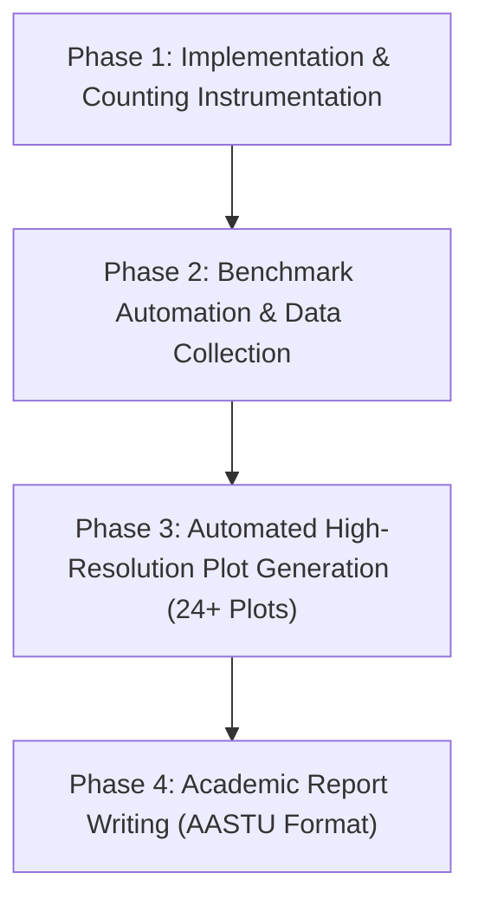

# SWEG 5012: Advanced Algorithms and Problem Solving
## Assignment 1: Analyzing the Complexity of Algorithms
### Addis Ababa Science and Technology University (AASTU) — Department of Software Engineering

---

## 1. What This Assignment Is Really About

At first glance, this assignment looks like standard programming practice, but it is not primarily about writing sorting code. You are analyzing **empirical algorithm performance** versus **theoretical complexity**.

When we give **Insertion Sort**, **Quick Sort**, and **Merge Sort** identical lists of numbers, we need to answer five core questions:
1. **Execution Time:** How many milliseconds does each algorithm take to sort the array?
2. **Operation Count:** How many direct element comparisons ($A[i] > A[j]$) does each perform?
3. **Scaling Behavior:** How does the performance scale as the list size ($n$) grows from small to large?
4. **Input Sensitivity:** How does the initial arrangement of data (random, already sorted, reverse sorted, or few items) alter the behavior?
5. **Hardware vs. Theory:** Why do comparison counts give a clean, machine-independent measure of complexity, while milliseconds fluctuate with hardware and CPU cache effects?

---

## 2. Detailed Breakdown of the Three Parts

### Part 1: Computing Running Time (in Milliseconds)
- **The Core Task:** Measure wall-clock / CPU execution time in milliseconds across increasing list lengths.
- **The 4 Input Types:**
  1. **Random list:** Elements are uniformly distributed in arbitrary order.
  2. **Ascending list:** Elements are already sorted from smallest to largest ($1, 2, 3, \dots, n$).
  3. **Descending list:** Elements are in reverse order ($n, n-1, \dots, 1$).
  4. **Few items / Few unique items:** Two complementary interpretations to cover:
     - *Interpretation A (Few Unique / High Duplication):* Arrays with many elements but drawn from a very small set of distinct values (e.g., $\{1, 2, 3, 4, 5\}$).
     - *Interpretation B (Small list sizes):* Testing behavior specifically on short arrays ($n \in [5, 10, 20, 50]$).
- **Increasing Lengths ($n$):** Test a sensible progression of sizes, such as:
  $$n \in [100, 500, 1000, 2000, 3000, 5000, 10000]$$
- **Measurement Method:** Use Python's high-resolution timer (`time.perf_counter()`), measuring in seconds and multiplying by 1,000 to get milliseconds.
- **Crucial Rule:** Always sort a fresh copy (`arr.copy()`), otherwise the first algorithm sorts the list and subsequent algorithms inadvertently test an already-sorted list!

---

### Part 2: Counting the Number of Operations (Comparisons)
- **The Core Task:** Modify the algorithms to track the exact number of key comparisons performed between array elements.
- **What Counts as an Operation?**
  - We specifically count comparisons between list elements (e.g., `arr[j] > key`, `arr[i] < pivot`, `left[i] <= right[j]`).
  - Index bounds checks (e.g., `j >= 0`) or loop counter updates are not element comparisons.
- **Why Both Time and Operations?**
  - Running time in milliseconds depends on CPU architecture, background tasks, and memory speed.
  - Comparison count is machine-independent: the exact same comparison count will be recorded whether run on a supercomputer or a laptop.
  - Comparing both metrics reveals physical hardware effects (such as CPU cache locality, branch prediction, and recursion overhead).

---

### Part 3: Interpretation of Results
You must analyze the shape of the curves and connect them to Big-O complexity classes:
- **Linear growth ($O(n)$):** A straight line.
- **Linearithmic growth ($O(n \log n)$):** Grows slightly faster than linear, staying relatively flat and smooth.
- **Quadratic growth ($O(n^2)$):** An upward-bending parabola where doubling the input quadruples the work.

#### Algorithm Behaviors Across Input Types

| Algorithm | Random Input | Ascending (Sorted) | Descending (Reverse) | Few Unique Items |
| :--- | :--- | :--- | :--- | :--- |
| **Insertion Sort** | $O(n^2)$ — elements shift an average of $n/4$ positions. | $O(n)$ — only 1 comparison per element, 0 shifts. | $O(n^2)$ — worst case; every element shifts past all preceding elements. | $O(n^2)$ — still requires shifting duplicates. |
| **Quick Sort** *(Naive Pivot)* | $O(n \log n)$ — partitions remain reasonably balanced on average. | $O(n^2)$ — partition splits into $0$ and $n-1$, degenerating into a linear scan. | $O(n^2)$ — same worst-case unbalanced splits. | Dependent on partition scheme (standard Lomuto degrades; Hoare or 3-way partition handles duplicates well). |
| **Merge Sort** | $\Theta(n \log n)$ — always splits in exact halves. | $\Theta(n \log n)$ — splits into halves regardless of ordering. | $\Theta(n \log n)$ — splits into halves regardless of ordering. | $\Theta(n \log n)$ — consistent divide-and-conquer depth $\log_2(n)$. |

---

## 3. Graph Strategy: 24 Dedicated Plots + Comparison Overlays

To avoid clutter and scaling issues (where an $O(n^2)$ curve at 25,000,000 operations completely flattens an $O(n \log n)$ curve at 100,000 operations), we produce dedicated graphs:

### Part 1: Execution Time (12 Graphs)
- **Insertion Sort:** Random, Ascending, Descending, Few Items (4 plots)
- **Quick Sort:** Random, Ascending, Descending, Few Items (4 plots)
- **Merge Sort:** Random, Ascending, Descending, Few Items (4 plots)

### Part 2: Comparison Counts (12 Graphs)
- **Insertion Sort:** Random, Ascending, Descending, Few Items (4 plots)
- **Quick Sort:** Random, Ascending, Descending, Few Items (4 plots)
- **Merge Sort:** Random, Ascending, Descending, Few Items (4 plots)

### Combined Comparison Overlays (4 Synthesis Graphs)
- Head-to-head comparison overlay for each input type showing all 3 algorithms on the same axis (with log-scaling where necessary).

---

## 4. Master Plan & Roadmap

### Phase 1: Implement Core Algorithms with Instrumented Counters
- Create `sorting_algorithms.py`:
  - `insertion_sort(arr)` returning `(sorted_arr, comparisons)`
  - `merge_sort(arr)` returning `(sorted_arr, comparisons)`
  - `quick_sort(arr)` returning `(sorted_arr, comparisons)` (with recursion limit handling to safely handle sorted lists up to $n=10,000$)

### Phase 2: Experiment Runner and Data Gathering
- Create `benchmark_runner.py`:
  - Input generator for Random, Ascending, Descending, and Few Items across sizes $n \in [100, 500, 1000, 2000, 3000, 5000, 7500, 10000]$.
  - Measure both CPU time (in ms) and operation counts across 3 trials per size to eliminate background noise.
  - Save all raw numbers into a structured CSV file (`results.csv`).

### Phase 3: Plot Generation Script
- Create `generate_plots.py` using `matplotlib`:
  - Save the 12 execution-time graphs as PNG images.
  - Save the 12 comparison-count graphs as PNG images.
  - Save summary comparison overlay graphs.

### Phase 4: Final Academic Report
- Generate the full report in Markdown / PDF ready for submission:
  - Following the complete AASTU SWEG 5012 Table of Contents.
  - Including all tables, embedded graphs, and comprehensive theoretical interpretations.

